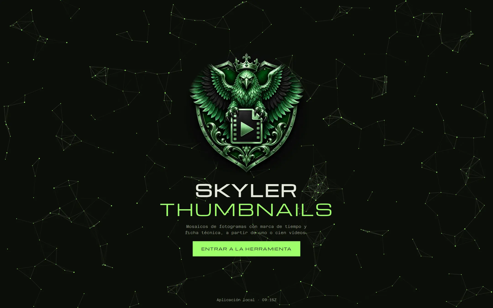
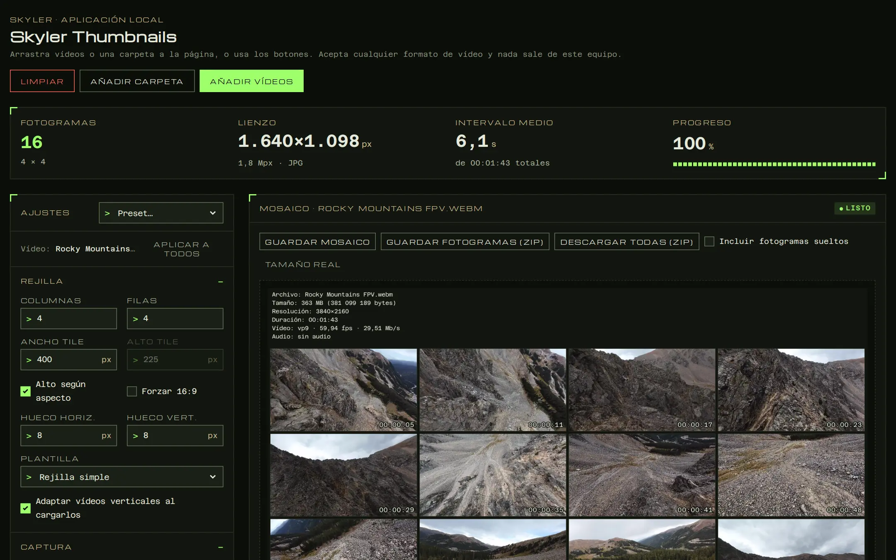
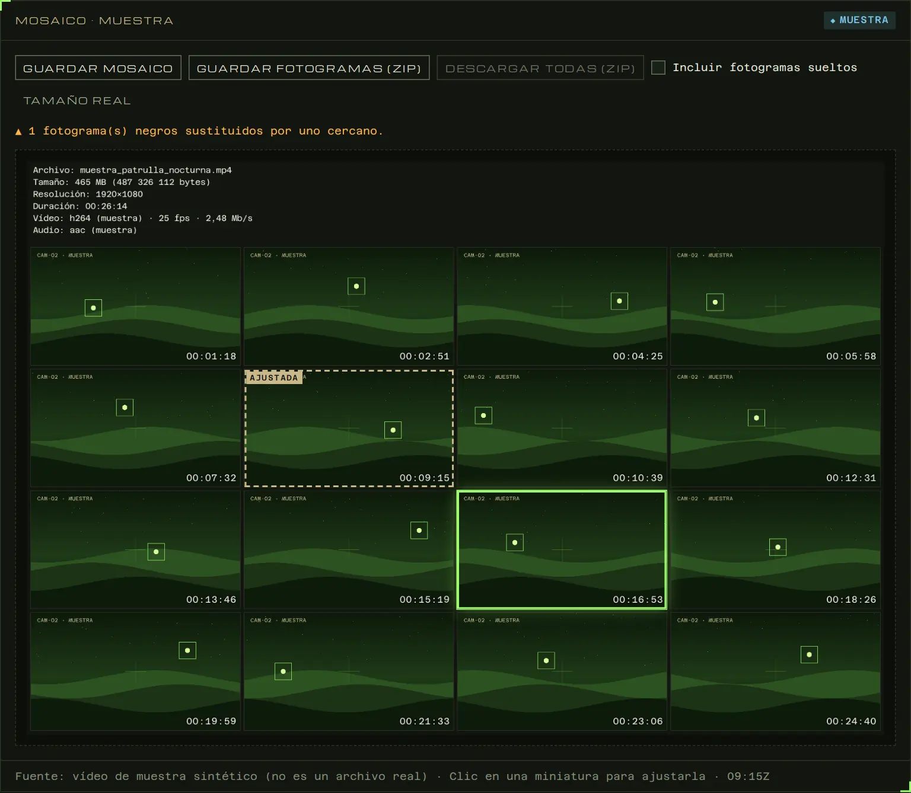
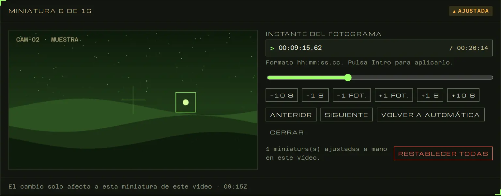
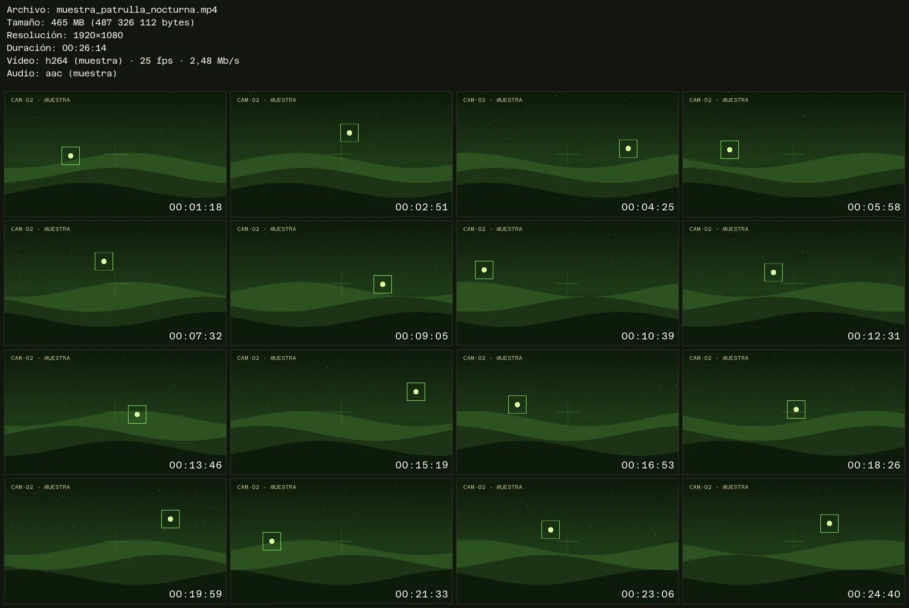
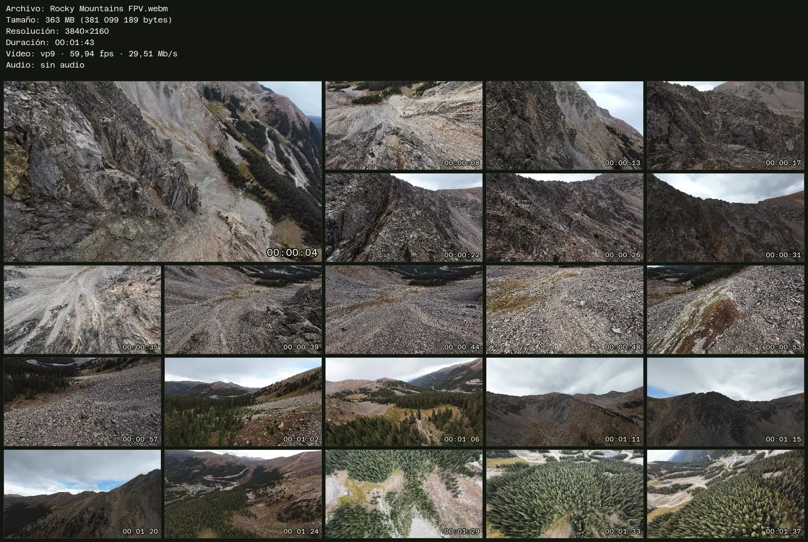

# SKYLER THUMBNAILS

**Mosaico de capturas de un vídeo en segundos.** 
Fotogramas repartidos por todo el vídeo, con su marca de tiempo y la ficha técnica del archivo, en una sola imagen.

## Qué es

Skyler Thumbnails convierte un vídeo en una **hoja de contactos**: una imagen con fotogramas tomados a lo largo de todo el metraje, cada uno con su marca de tiempo y, arriba, los datos del archivo. Sirve para revisar de un vistazo grabaciones largas, catalogar material, enviar un resumen visual de un vídeo o elegir el plano bueno sin reproducirlo entero.

Funciona **en tu ordenador**: se abre en el navegador, pero los vídeos no salen de tu equipo y no necesita conexión a internet. Lee prácticamente cualquier formato gracias a FFmpeg, que va incluido.

## Lo que puedes hacer

| | |
|---|---|
| **Cualquier formato** | MP4, MKV, MOV, AVI, WMV, HEVC/H.265, AV1, VP9… si FFmpeg lo lee, sirve. |
| **Rejilla a medida** | Filas y columnas, tamaño de miniatura, huecos, o un fotograma cada N segundos. Plantillas con una miniatura destacada de 2 × 2. |
| **Fotogramas con criterio** | Salta el principio y los créditos, reparte los fotogramas, los aleatoriza si quieres y sustituye solo los fotogramas negros. |
| **Cada miniatura, a tu gusto** | Haz clic en una miniatura y elige otro instante: con la barra, escribiendo la hora o fotograma a fotograma. |
| **Ajustes por vídeo** | Cada vídeo de la cola guarda su propia configuración; los verticales se adaptan solos. |
| **Ficha técnica** | Nombre, tamaño, resolución, duración, códecs, fps y tasa de bits en la cabecera. |
| **Estilo** | Marca de tiempo, sombras, bordes, escala de grises, color o imagen de fondo y marca de agua. |
| **Por lotes** | Carga una carpeta entera y descarga todas las hojas en un ZIP, con los fotogramas sueltos si los quieres. |
| **4K sin esfuerzo** | Vídeos 4K, 60 fps y códecs modernos: FFmpeg extrae cada fotograma a resolución completa. |
| **Salida** | JPG, PNG o WebP. Presets propios que puedes exportar e importar. |

### Ajusta cualquier miniatura

Si un fotograma no te convence, haz clic en él y elige otro. Las miniaturas cambiadas quedan marcadas y puedes devolverlas a automático cuando quieras.

  

### Resultados

&nbsp;

 
Rejilla de 4 × 4 y plantilla de 5 × 5 con miniatura destacada, sacadas de un vídeo 4K de 1 min 43 s.

## Descargar

Descarga el paquete de tu sistema desde **[la última versión](../../releases/latest)**:

| Sistema | Descarga |
|---|---|
| **Windows 10/11** · Intel o AMD (64 bits) | [Skyler-Thumbnails-1.0.1-windows-x64.zip](../../releases/latest/download/Skyler-Thumbnails-1.0.1-windows-x64.zip) |
| **Windows 11 ARM** · Snapdragon, Surface Pro X… | [Skyler-Thumbnails-1.0.1-windows-arm64.zip](../../releases/latest/download/Skyler-Thumbnails-1.0.1-windows-arm64.zip) |
| **Linux** · x86-64 | [Skyler-Thumbnails-1.0.1-linux-x64.tar.gz](../../releases/latest/download/Skyler-Thumbnails-1.0.1-linux-x64.tar.gz) |
| **Linux** · ARM64 (Raspberry Pi 4/5…) | [Skyler-Thumbnails-1.0.1-linux-arm64.tar.gz](../../releases/latest/download/Skyler-Thumbnails-1.0.1-linux-arm64.tar.gz) |

## Empezar en 30 segundos

1. **Descomprime** el paquete donde quieras. No hay que instalar nada.
2. **Abre** la aplicación:
   - Windows: doble clic en `Skyler-Thumbnails.exe`.
   - Linux: `./iniciar.sh`.
3. Se abre el navegador. Pulsa **Entrar a la herramienta** y arrastra tus vídeos o una carpeta.
4. Ajusta la rejilla, retoca las miniaturas que quieras y pulsa **Guardar mosaico** o **Descargar todas (ZIP)**.
5. Para salir, **cierra la pestaña**: la aplicación se apaga sola a los pocos segundos.

<b>Windows dice «Windows protegió su PC»</b>

El ejecutable no está firmado con un certificado comercial, y SmartScreen avisa la primera vez. Pulsa **Más información → Ejecutar de todas formas**. Solo ocurre una vez.

<b>¿Mis vídeos se suben a algún sitio?</b>

No. La aplicación funciona entera en tu equipo y solo acepta conexiones del propio ordenador. Mientras trabajas guarda una copia temporal de cada vídeo cargado, que se borra al pulsar **Limpiar** o al cerrar la aplicación.

<b>Un vídeo no se carga</b>

Pulsa su fila en la cola para ver el motivo. Si el archivo está dañado o no tiene pista de vídeo, FFmpeg no podrá leerlo. Comprueba que se reproduce bien en otro programa.

<b>El navegador no se abre solo</b>

Abre tú mismo `http://localhost:8765`. Si ese puerto está ocupado por otro programa, la aplicación usa el siguiente libre (8766, 8767…).

## Licencia

**© 2026 Skyler. Todos los derechos reservados.**

Skyler Thumbnails es **gratuito para usar tal como se distribuye**, en casa o en el trabajo, y las imágenes que generes son tuyas. **No está permitido modificarlo, redistribuirlo ni crear versiones derivadas.** Para compartirlo, enlaza a esta página. Condiciones completas en [LICENSE](LICENSE).

Incluye FFmpeg, JSZip, las tipografías Michroma y Azeret Mono y la biblioteca estándar de Go, que conservan sus propias licencias: ver [THIRD_PARTY.md](THIRD_PARTY.md).

### Créditos de las capturas

Las capturas de esta página muestran fotogramas de [«Flying the Rocky Mountains: Stunning FPV Drone Footage»](https://commons.wikimedia.org/wiki/File:Flying_the_Rocky_Mountains-_Stunning_FPV_Drone_Footage.webm), de **EagleView**, publicado en Wikimedia Commons con licencia [CC BY 3.0](https://creativecommons.org/licenses/by/3.0/). Los fotogramas se han extraído y compuesto en mosaico con Skyler Thumbnails. Esa licencia cubre solo esas imágenes, no la aplicación.

 
Hecho por <b>Skyler</b>

